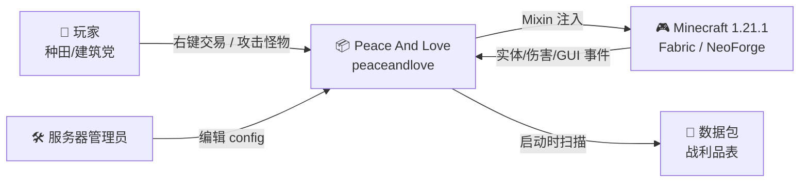
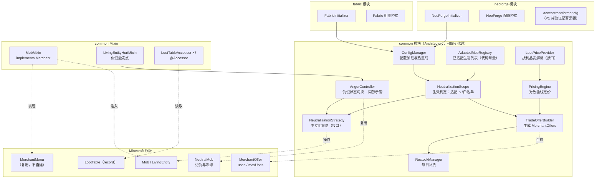
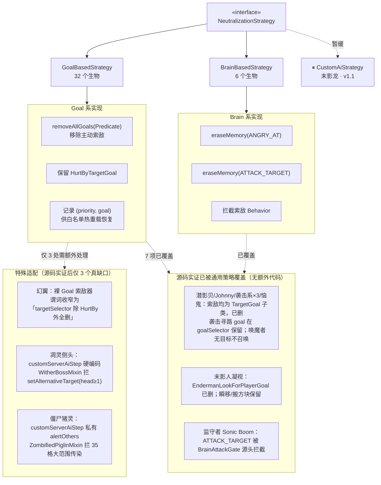
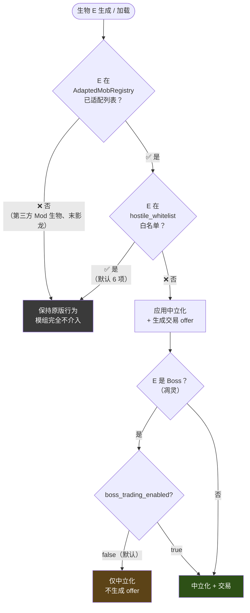
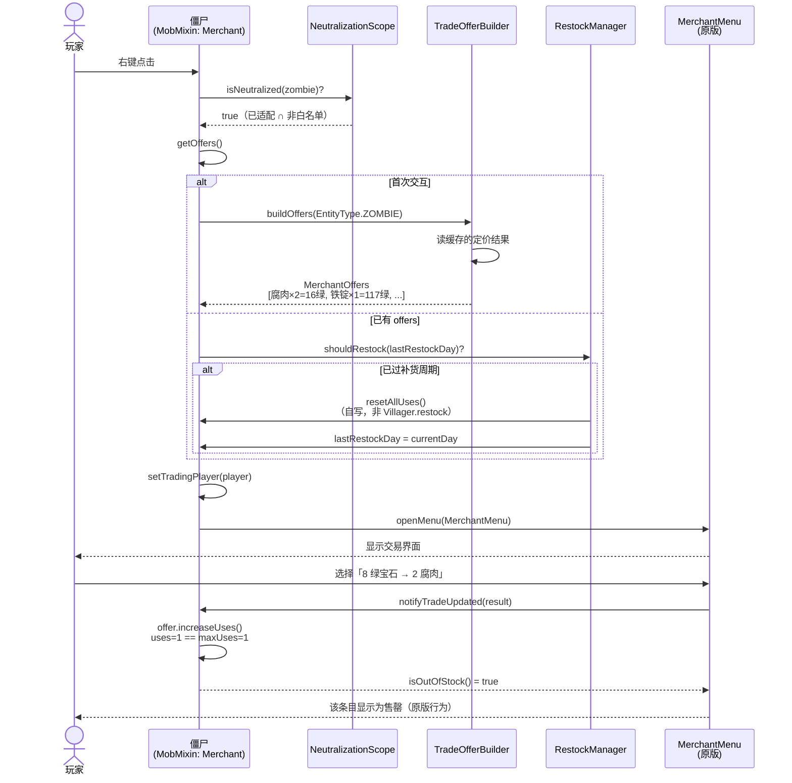
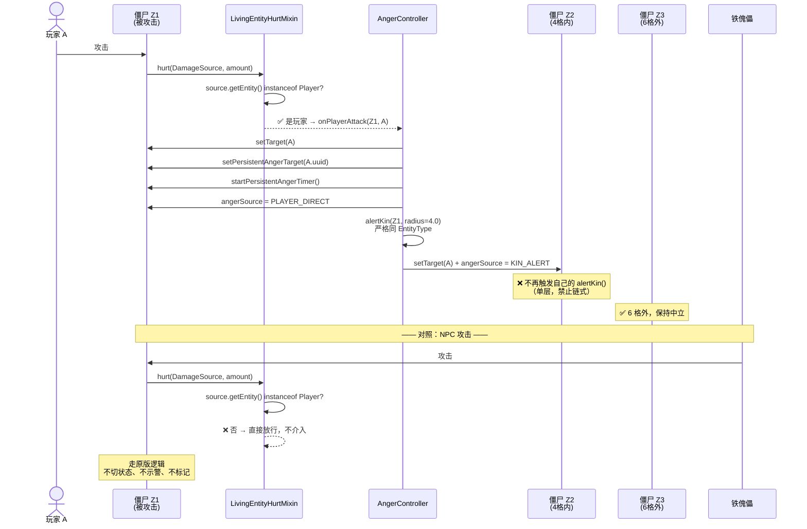
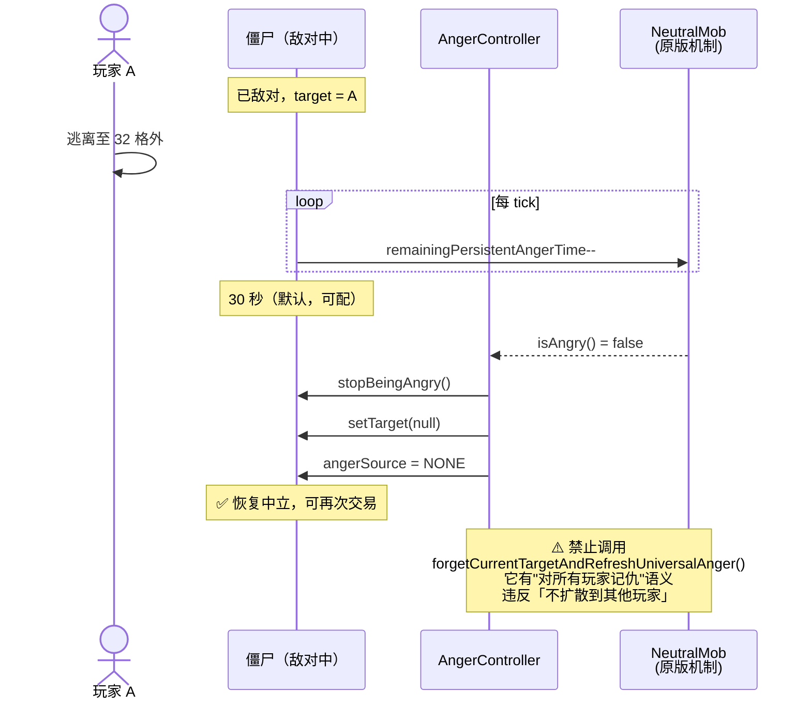
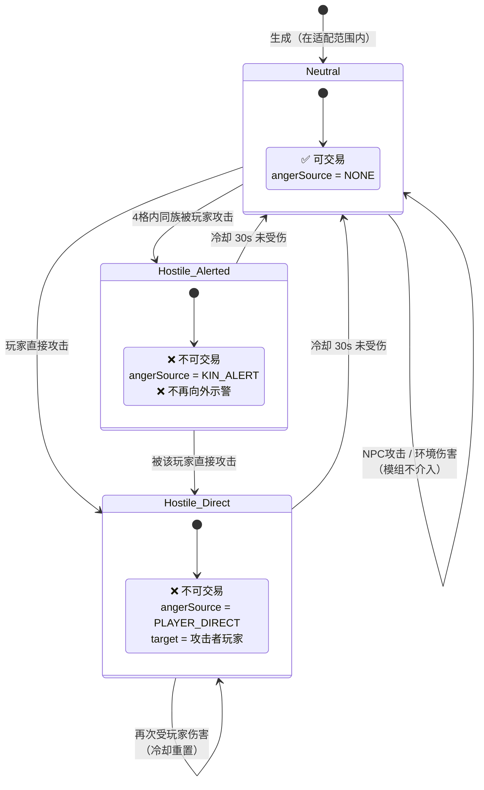
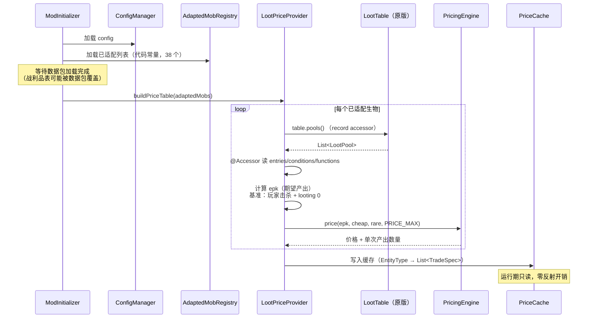
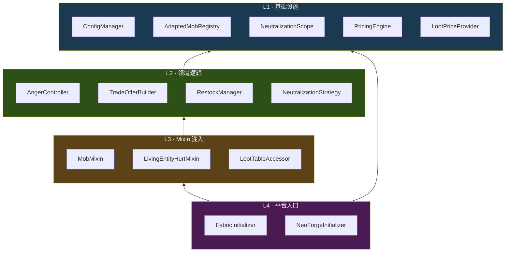

# Peace And Love — 架构图

- 版本：v1.0
- 日期：2026-09-11
- 绘图规范：**优先 Mermaid**，仅在 Mermaid 表达受限处降级 ASCII

---

## 1. Context 图（C4 Level 1）



---

## 2. Container 图（C4 Level 2）



---

## 3. Component 图 —— 中立化策略



---

## 4. 生效范围判定（决策核心）



---

## 5. 时序图 —— 场景 1：玩家与中立僵尸交易



---

## 6. 时序图 —— 场景 2：玩家攻击触发仇恨 + 同族示警

> ★ 核心语义：**仅玩家攻击触发**，仇恨**只锁定该玩家**，**单层不链式**



---

## 7. 时序图 —— 场景 3：仇恨冷却回归中立



---

## 8. 状态机 —— 生物的中立/敌对状态



---

## 9. 启动时序 —— 定价表构建



---

## 10. 模块依赖图



**依赖规则：**
- L1 不依赖任何上层，可独立单测
- L2 只依赖 L1，业务逻辑与 MC API 解耦（便于单测）
- L3 是唯一接触 MC 内部实现的层，版本适配集中于此
- L4 平台专属，尽量薄

---

## 11. 定价曲线（ASCII，Mermaid 不适合数值曲线）

> 数据来自 `spikes/design-verify/final_pricing_128.json`，
> 110 个条目单调性 **100% 通过**，**零条目撞上限**。

```
价格
 ↑
128 ┤                                                   ╭── (epk=0.005)
    │                                             ╭─────╯
117 ┤                                        ╭────╯  ← 僵尸铁锭 (epk=0.0083)
    │                                  ╭─────╯
 94 ┤                            ╭─────╯  ← 骷髅头颅 (epk=0.025)
    │                      ╭─────╯
 63 ┤                ╭─────╯  ← 黏液球 (epk=0.105)
 62 ┤               ╭╯        ← 铜锭 (epk=0.11)
    │          ╭────╯
 39 ┤     ╭────╯              ← 蜘蛛眼/煤炭 (epk=0.333)
 30 ┤  ╭──╯                   ← 末影珍珠/烈焰棒 (epk=0.5)
 16 ┤╭─╯                      ← 腐肉/骨头/火药 (epk=1.0)
  7 ┤╯                        ← 旋风人棒 (epk=1.5)
  1 ┼──┬────┬────┬─────┬─────┬─────┬─────┬──→ epk（对数轴）
   2.0 1.0  0.5  0.11  0.025 0.01  0.005

    特性：产出每减半 → 价格稳定 +14.7 绿宝石
```

### 价格分布（110 条）

```
    1- 16 : 55  ███████████████████████████████████████████████████████
   17- 32 : 17  █████████████████
   33- 48 : 14  ██████████████
   49- 64 :  4  ████
   65- 80 :  7  ███████
   81- 96 :  3  ███
   97-112 :  1  █
  113-128 :  9  █████████

  撞上限(128)：0 个        撞下限(1)：11 个（红石等高产出物品）
```

### 代表性定价（实测）

| 生物 | 物品 | epk | 价格 | 单次产出 |
|------|------|-----|------|---------|
| 僵尸 | 铁锭 / 胡萝卜 / 马铃薯 | 0.0083 | **117** | 1 |
| 凋灵骷髅 | 凋灵骷髅头颅 | 0.0250 | **94** | 1 |
| 史莱姆 | 黏液球 | 0.1050 | 63 | 2 |
| 溺尸 | 铜锭 | 0.1100 | 62 | 1 |
| 凋灵骷髅 | 煤炭 | 0.3333 | 39 | 1 |
| 洞穴蜘蛛 | 蜘蛛眼 | 0.3333 | 39 | 1 |
| 末影人 | 末影珍珠 | 0.5000 | 30 | 1 |
| 烈焰人 | 烈焰棒 | 0.5000 | 30 | 1 |
| 潜影贝 | 潜影壳 | 0.5000 | 30 | 1 |
| 恶魂 | 恶魂之泪 | 0.5000 | 30 | 1 |
| 僵尸 | 腐肉 | 1.0000 | 16 | 2 |
| 骷髅 | 骨头 / 箭 | 1.0000 | 16 | 2 |
| 苦力怕 | 火药 | 1.0000 | 16 | 2 |
| 监守者 | 幽匿催发体 | 1.0000 | 16 | 1 |
| 旋风人 | 旋风人棒 | 1.5000 | 7 | 2 |
| 女巫 | 红石 | 6.0000 | 1 | 8 |

---

## 变更记录

| 日期 | 版本 | 内容 |
|------|------|------|
| 2026-09-11 | v1.0 | 首版：Context/Container/Component 三层 + 4 张时序图 + 状态机 + 模块依赖 |
