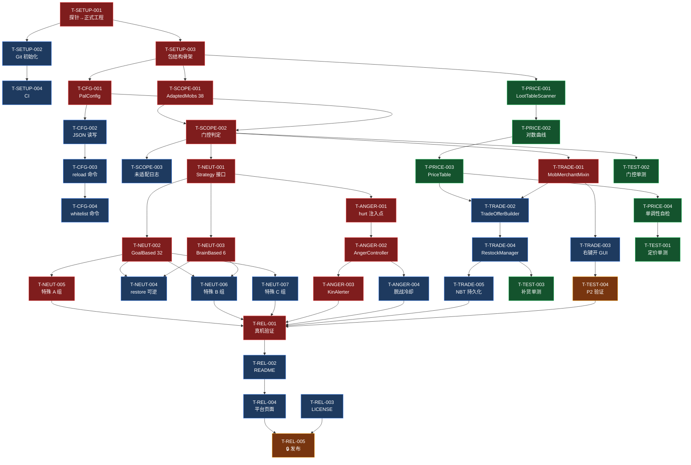
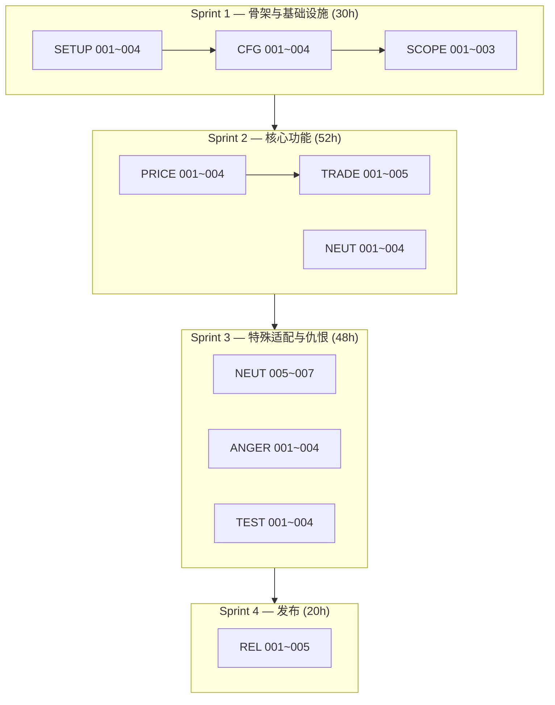

# Peace And Love — 任务依赖图

- 版本：v1.0
- 日期：2026-09-11
- 配套：`03-decomposition.md`

---

## 1. 全局依赖图



**图例：**

- 🔴 红色 = 关键路径
- 🔵 蓝色 = 普通任务
- 🟢 绿色 = 可并行（不在关键路径）
- 🟠 橙色 = 需门控/人工确认

---

## 2. 关键路径（最长串行链）

```mermaid
graph LR
    classDef cp fill:#7f1d1d,stroke:#ef4444,color:#fff

    A["T-SETUP-001<br/>3h"]:::cp --> B["T-SETUP-003<br/>2h"]:::cp
    B --> C["T-CFG-001<br/>3h"]:::cp
    C --> D["T-SCOPE-002<br/>3h"]:::cp
    D --> E["T-NEUT-001<br/>3h"]:::cp
    E --> F["T-NEUT-002<br/>6h"]:::cp
    F --> G["T-NEUT-005<br/>8h"]:::cp
    G --> H["T-REL-001<br/>8h"]:::cp
    H --> I["T-REL-002<br/>4h"]:::cp
    I --> J["T-REL-004<br/>4h"]:::cp
    J --> K["T-REL-005<br/>2h"]:::cp
```



**关键路径累计：3+2+3+3+3+6+8+8+4+4+2 = 46h**

另有一条几乎等长的仇恨链：

```
T-NEUT-001(3h) → T-ANGER-001(4h) → T-ANGER-002(5h) → T-ANGER-003(5h) → T-REL-001
累计到 T-REL-001 前：17h
```

两条链在 `T-REL-001` 汇合，**实际关键路径取较长者 ≈ 62h**（含 Sprint 间切换开销）。

---

## 3. Sprint 泳道图



---

## 4. 里程碑验收点

| 里程碑 | 时点 | 验收标准 | 验证方式 |
|--------|------|---------|---------|
| **M1** | Sprint 1 末 | 服务端启动、`reload`/`whitelist` 命令可用、门控判定正确（尚无行为变化） | 服务端实测 + 单测 |
| **M2** | Sprint 2 末 | 38 生物不主动攻击、右键开交易界面、价格正确、每日 1 次 | **必须真机** |
| **M3** | Sprint 3 末 | 仇恨三条硬约束全满足、10 个特殊生物行为正确、P2 结论明确 | **必须真机** |
| **M4** | Sprint 4 末 | v1.0 发布 | **须用户确认** |

---

## 5. 阻塞关系提示

| 若卡住 | 会阻塞 | 建议 |
|--------|--------|------|
| T-SETUP-001 | **全部** | 最高优先，探针工程已验证可直接演进 |
| T-SCOPE-002 | TRADE / NEUT / TEST 三个 Epic | 门控是枢纽，务必先做对 |
| T-NEUT-002 | 全部特殊适配 | `removeAllGoals(Predicate)` 已验证存在 |
| T-TEST-004 (P2) | 发布文案定位 | 若不成立需改宣传口径，故提前到 Sprint 3 |

---

## 变更记录

| 日期 | 版本 | 作者 | 变更 |
|------|------|------|------|
| 2026-09-11 | v1.0 | Hermes | 初版依赖图 |
